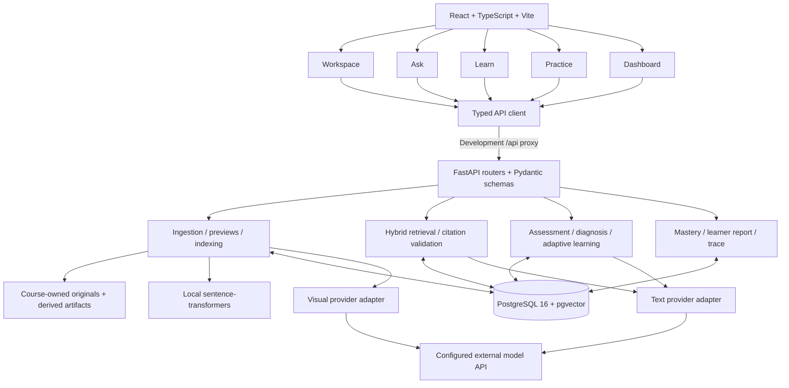
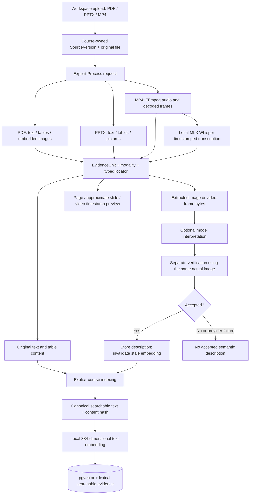
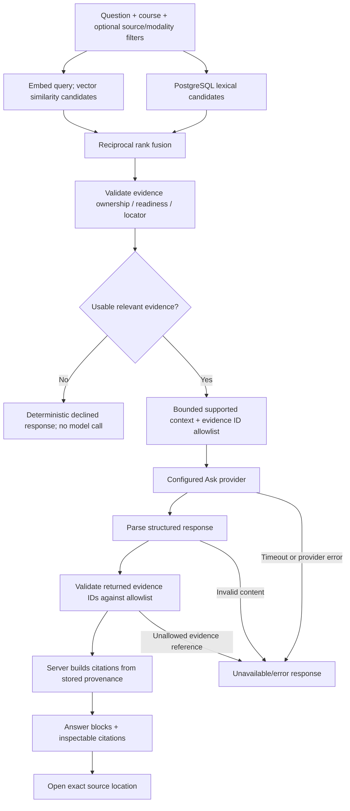
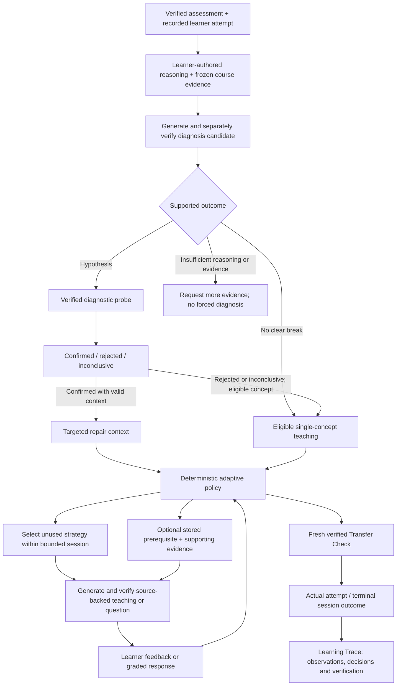
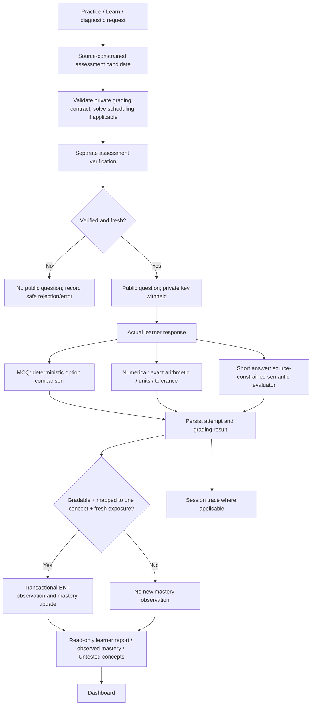

# ConceptLens architecture

**Source-reviewed draft · commit `9fe1751` · 14 October 2026.** These diagrams describe the accessible implementation. They do not certify a successful real-provider journey or the unavailable Concept Observatory frontend. See [verification](VERIFICATION.md) and [repository provenance](INDEX.md).

## 1. Application structure

The backend is a modular monolith, not a microservice or distributed-agent deployment. FastAPI mounts course/source, retrieval, Ask, assessment, mastery, diagnosis, adaptive-learning, preview, visual-evidence and report routers. SQLAlchemy models and Alembic migrations define persistence; migration head is `0007`.

The frontend uses React Router for exactly five principal routes. Workspace manages sources; Ask presents grounded answers; Learn hosts reasoning and adaptive sessions; Practice exposes assessments and diagnostics; Dashboard presents concept/mastery/report data. Shared components render source previews, reasoning, teaching and Learning Trace.

The browser stores a learner UUID and journey references scoped to learner/course. This identifier is not authentication. Course ownership checks provide internal data-scope boundaries, not an authenticated multi-user security model. The development proxy removes `/api`; the API routes themselves do not use that prefix.

**Source:** [frontend routes](../../frontend/src/App.tsx), [API client](../../frontend/src/api/client.ts), [state](../../frontend/src/state.tsx), [Vite config](../../frontend/vite.config.ts), [API entry](../../backend/app/main.py), [models](../../backend/app/models), [migrations](../../backend/alembic/versions).

## 2. Multimodal ingestion and document processing

Processing dispatches by source type. PDF uses PyMuPDF/pdfplumber; PPTX uses python-pptx; video uses FFmpeg/FFprobe and the configured local transcription adapter. Originals and derived images are file-backed; evidence metadata, descriptions and vectors reside in the database. There is no general scanned-PDF OCR path and no standalone image/audio upload route claimed here.

Locators preserve page, slide or time provenance. Image extraction does not establish semantic understanding. Only accepted descriptions contribute semantic text; changing a description invalidates its old embedding. Workspace must explicitly re-index afterward. The text embedding provider defaults to `sentence-transformers/all-MiniLM-L6-v2` and validates 384-dimensional outputs; it does not embed raw images or video directly.

Previews resolve files through course/source ownership and contained storage paths. PDF pages render from the original. PPTX previews reconstruct supported content at slide coordinates and can omit complex Office features. Video opens at the referenced timestamp. Original-file access remains available.

**Source:** [source routes](../../backend/app/api/sources.py), [dispatch](../../backend/app/services/source_processing.py), [PDF](../../backend/app/services/pdf_ingestion.py), [PPTX](../../backend/app/services/pptx_ingestion.py), [video](../../backend/app/services/video_ingestion.py), [transcription](../../backend/app/services/transcription.py), [visual interpretation](../../backend/app/services/visual_evidence.py), [indexing](../../backend/app/services/indexing.py), [embeddings](../../backend/app/services/embedding_provider.py), [previews](../../backend/app/services/source_preview.py).

## 3. Retrieval and source-grounded answering

Hybrid retrieval merges vector and lexical rankings. The evidence boundary rejects insufficient support before creating a provider. Answer generation receives a bounded context; the model returns evidence IDs, not authoritative filenames or locators. The server validates those IDs and supplies the citation objects.

These structural/provenance safeguards do not mathematically prove that every generated sentence is entailed. Ask does not have the same separate content-verifier stage as assessment generation. Real answer quality and grounding metrics remain pending.

**Source:** [retriever](../../backend/app/services/retriever.py), [citation checks](../../backend/app/services/citation_grounding.py), [evidence boundary](../../backend/app/services/evidence_boundary.py), [Ask orchestration](../../backend/app/services/grounded_ask.py), [SourceViewer](../../frontend/src/components/SourceViewer.tsx).

## 4. Reasoning diagnosis and adaptive learning

The system diagnoses reasoning the learner supplies; it does not inspect private model reasoning or infer an enduring learner trait from one wrong answer. Diagnostic probe responses resolve the event-specific hypothesis. Probes do not create mastery gains. Concept-level teaching after an unresolved/rejected diagnosis does not rewrite that diagnosis as confirmed.

The model generates content for a server-selected strategy. It does not control the adaptive policy. Strategies include source explanation, structured visual teaching, worked examples, prerequisite checks/recaps/practice and transfer. Visual teaching is structured steps/timelines/annotations, not image generation. Prerequisite interventions require a real recorded edge and usable evidence. The session prevents strategy repetition and bounds the learning loop; freshness checks and separate verifier prompts guard transfer candidates, but are not proof of pedagogical effectiveness.

**Source:** [diagnosis](../../backend/app/services/reasoning_diagnosis.py), [adaptive policy](../../backend/app/services/adaptive_learning.py), [adaptive schemas](../../backend/app/schemas/adaptive_learning.py), [reasoning component](../../frontend/src/components/Reasoning.tsx), [teaching component](../../frontend/src/components/Teaching.tsx), [trace panel](../../frontend/src/components/TracePanel.tsx).

## 5. Practice, verification and Dashboard updates

Assessment verification precedes presentation; private answer keys and grading contracts are withheld until submission. MCQ grading compares the selected option. Numerical grading uses exact values with explicit units/tolerance; supported scheduling contracts use the generic solver. Short-answer evaluation may return `cannot_grade`; unsupported or unavailable grading must not award credit or update mastery.

Mastery updates require one unambiguous course concept and no prior exposure to the question. Repeated questions, unmapped/ambiguous questions and ungradable attempts do not manufacture observations. A prior ungradable exposure can also prevent a later response to that same question from contributing new mastery evidence. Teaching itself never calls an observation a correct answer.

BKT updates are persisted with before/after values. The Dashboard report separately summarizes first gradable responses and repeated/ungradable responses; report scores and BKT observations have different eligibility rules. Untested concepts remain untested. The short diagnostic selects a small fresh sample from course concepts and may generate additional verified questions when needed; it is not a validated psychometric instrument.

**Source:** [assessment generation](../../backend/app/services/assessment_generation.py), [grading](../../backend/app/services/assessment_grading.py), [typed assessments](../../backend/app/services/typed_assessment.py), [scheduling](../../backend/app/services/scheduling.py), [mastery updates](../../backend/app/services/mastery_update.py), [BKT](../../backend/app/services/learner_mastery.py), [diagnostic selection](../../backend/app/services/cold_start.py), [report](../../backend/app/services/learner_report.py), [Dashboard](../../frontend/src/views/Dashboard.tsx).

## Model integration and deployment boundary

| Inspected mode | Transport and routing | What remains unverified |
| --- | --- | --- |
| `compatible` (default) | Configured base URL plus `/chat/completions`; text model and optional vision model. Separate verification calls use the same configured provider/model. | Actual gateway completion, schema support and model quality |
| `direct_openai` | Direct Responses adapter; light/standard/deep routing in source. Concise Ask uses light; normal generation uses standard; wired verification uses deep. | Authorized access to the exact source identifiers and successful live generation/verification |

Tier names and settings are documented in the [README draft](README_REVIEW_DRAFT.md#model-api-and-gateway-configuration). They are implementation facts, not claims about public model availability. No private endpoint details or credentials are required to understand the architecture. The older demo helper requires explicit mode isolation; see its caveat in the README draft.

The inspected application has no authentication, external queue, production hosting configuration or successful deployment claim. Local browser/API/database communication and fixture-tested provider adapters must be distinguished from a working external completion and a verified full learning loop.

**Source:** [configuration](../../backend/app/core/config.py), [compatible provider and routing](../../backend/app/services/llm_provider.py), [direct adapter](../../backend/app/services/direct_openai.py), [demo helper](../../demo-course/prepare.py).
